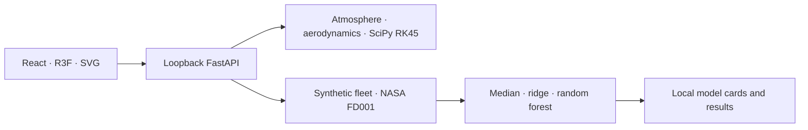

# AeroForge

**Design. Simulate. Diagnose.** AeroForge is an open-source, CPU-first aircraft engineering and turbofan prognostics workbench. Design a parametric airframe or load a [real-aircraft geometry preset](docs/AIRFRAME_PRESETS.md), integrate a longitudinal flight segment, and compare RUL models on synthetic or NASA C-MAPSS FD001 trajectories.

**Research and education only — not for operational flight or maintenance decisions.** AeroForge is an independent project. NASA has no affiliation with or endorsement of AeroForge.


## Get started

Install Python 3.11–3.13 and Node.js 20+. A WebGL-capable browser enables the interactive 3D views. A laptop CPU is sufficient. Initial setup downloads Python and npm dependencies. The application requires no account, API key, Docker, cloud backend, or GPU compute.

```sh
python scripts/bootstrap.py
python scripts/dev.py
python scripts/verify.py --running
```

Open [AeroForge](http://localhost:5173) and [API docs](http://127.0.0.1:8000/docs). Stop both services with Ctrl+C. To run verification with the app stopped, use `python scripts/verify.py`. Browser E2E uses installed Chrome or Playwright Chromium.

## Research modes

| Mode | Features |
| --- | --- |
| Demo | Offline airframe design, flight force calculations, integrated trajectory, synthetic fleet explorer and reproducible benchmarks. |
| NASA research | Opt-in FD001 download or ZIP import, fleet diagnostics, grouped training, final test scoring and saved model inference. All inputs and artifacts stay in the local workspace. |
| Advanced | Sources documents OpenVSP, Aviary and ASRS. Adapters for these are roadmap items. |

Use **Research & Sources → Download FD001** or upload the ZIP obtained from [NASA PCoE](https://www.nasa.gov/intelligent-systems-division/discovery-and-systems-health/pcoe/pcoe-data-set-repository/). An equivalent CLI is `.venv/bin/python scripts/download_nasa.py`. The importer records its source, UTC timestamp and SHA-256. See [NASA's data catalogue](https://data.nasa.gov/dataset/cmapss-jet-engine-simulated-data) and [data sources and licensing](docs/DATA_SOURCES.md).

## Architecture



Wing geometry feeds the analytic physics model. NASA C-MAPSS is a separate simulator dataset with test endpoint RUL labels in operating cycles. Experiments fit on grouped training engines, validate on disjoint truncated endpoints, and score the official test partition only when requested. Reported metrics include MAE, RMSE and the asymmetric PHM score. See the [computed comparisons](docs/BENCHMARKS.md), [benchmark protocol](docs/REPRODUCIBILITY.md), [scientific validation](docs/SCIENTIFIC_VALIDATION.md), [architecture](docs/ARCHITECTURE.md) and [limitations](docs/LIMITATIONS.md).

The NASA Ames dataset citation is Saxena and Goebel (2008), *Turbofan Engine Degradation Simulation Data Set*, NASA Prognostics Data Repository. The flight model uses [NASA Glenn's atmosphere material](https://www1.grc.nasa.gov/beginners-guide-to-aeronautics/earth-atmosphere-equation-english/) and standard atmosphere reference constants.

## Contribute

Possible extensions include FD002–FD004 condition-aware validation, calibrated uncertainty on independent fleets, and tested OpenVSP/Aviary adapters. See [Contributing](CONTRIBUTING.md) and [Security](SECURITY.md). Original AeroForge code is [Apache-2.0](LICENSE). Dependencies and third-party sources retain their original licensing terms.
